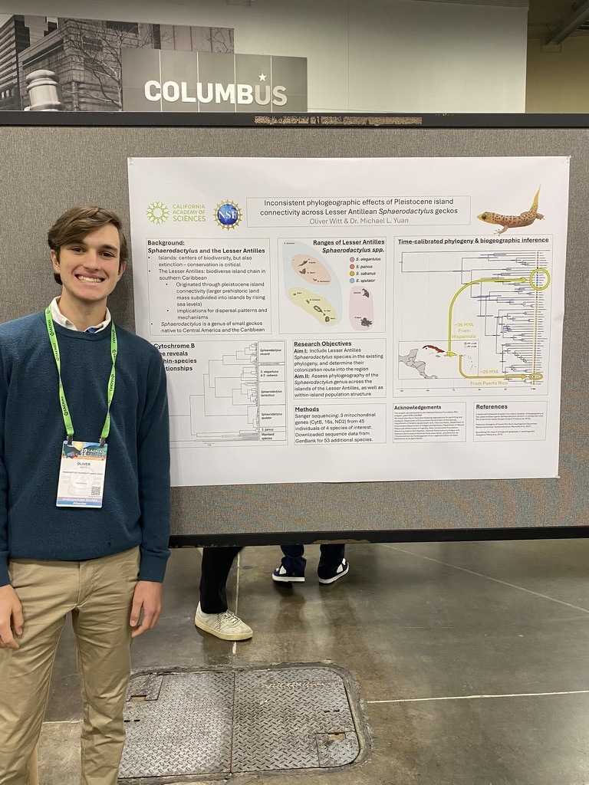

Research project studying the effects of Pleistocene island connectivity in the Caribbean on the distribution and speciation of _Sphaerodactylus_ geckos. Advised by Dr. Michael Yuan.  Presented as a research poster at SACNAS 2025, as well as a forthcoming peer-reviewed paper.

